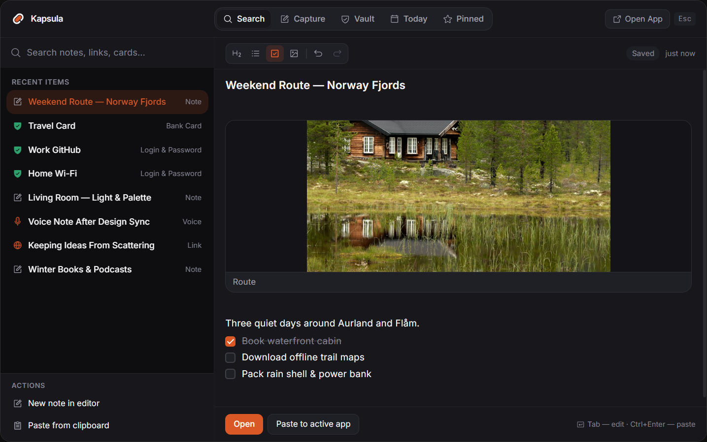
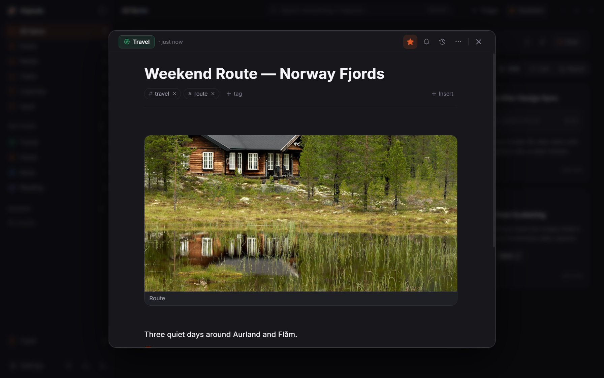
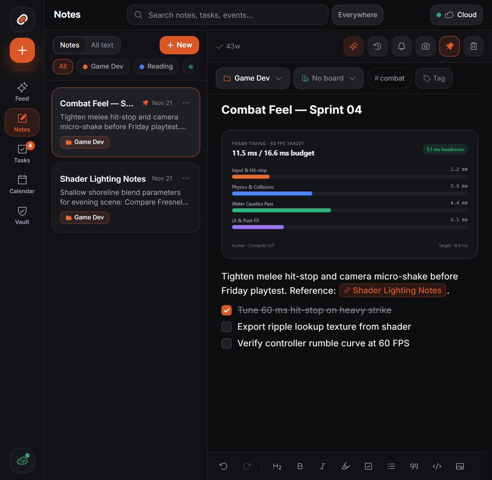
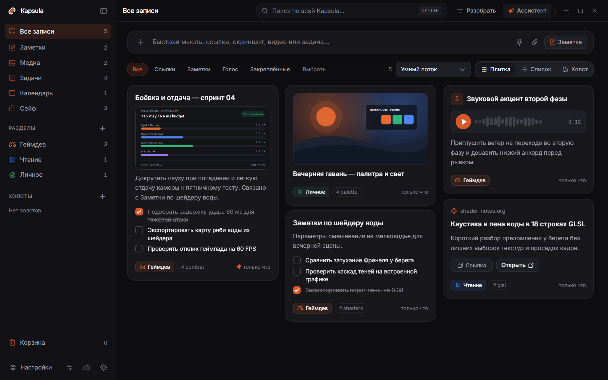
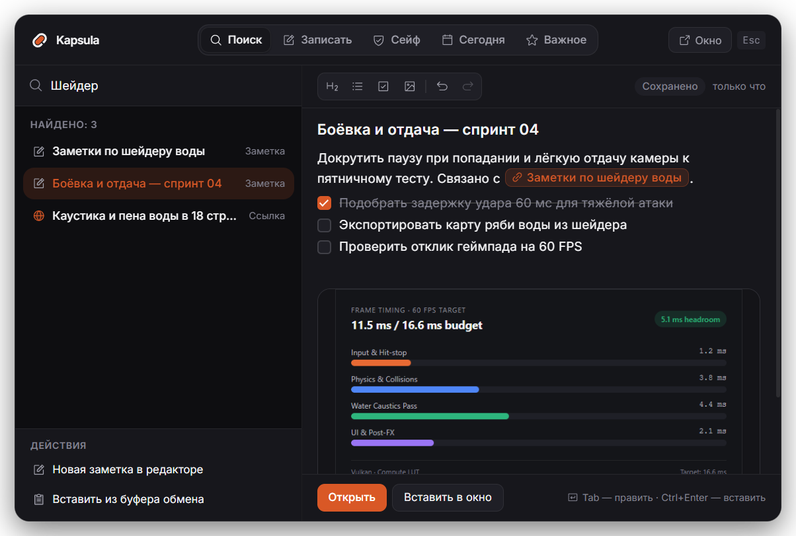
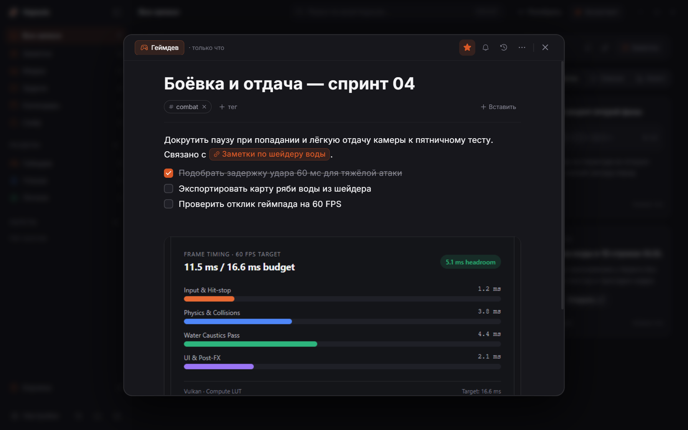
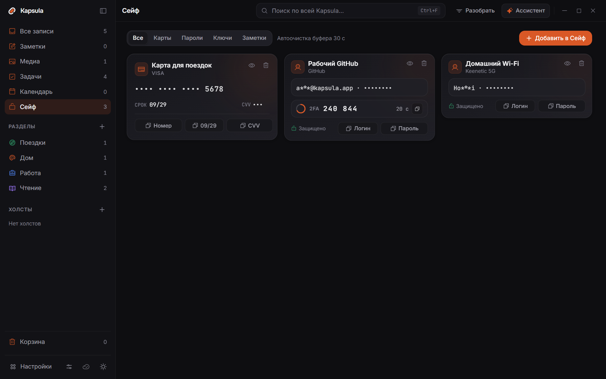
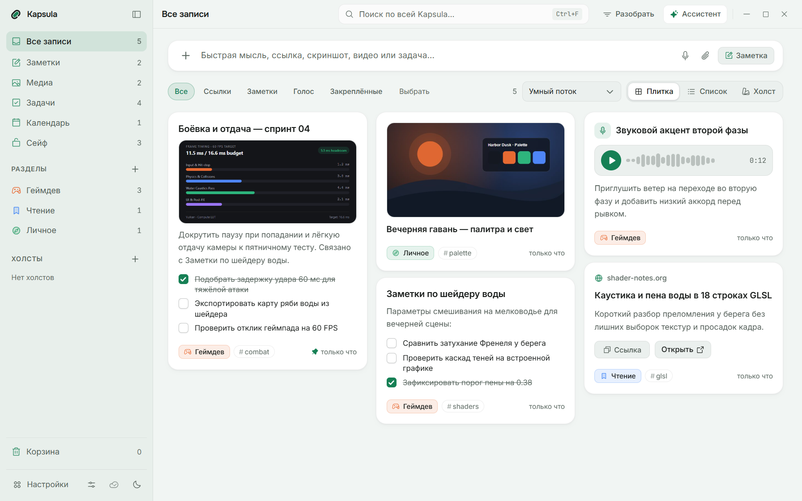
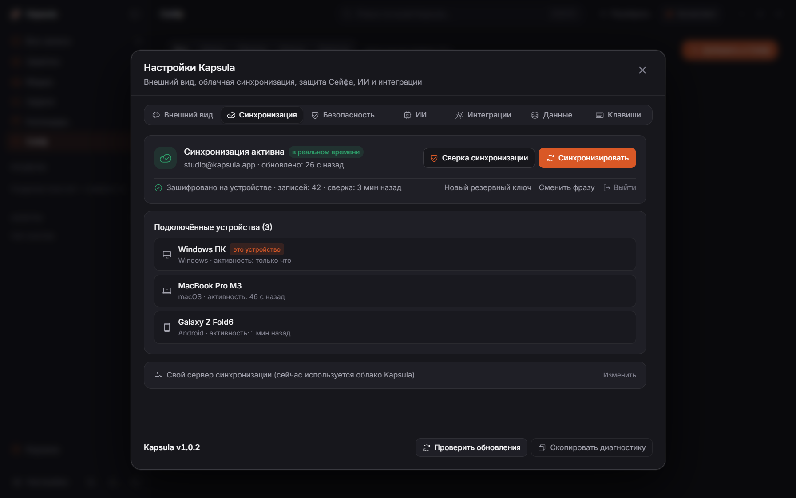

<div align="center">


# Kapsula

**Private-first workspace for notes, web captures, tasks, and encrypted secrets — synced across Windows, macOS, and Android.**

[](https://github.com/Suther1and/kapsula/releases/tag/v1.0.7)
[](#download-v107)
[](#english)
[](LICENSE)

**[English](#english)** · **[Русский](#русский)** · **[Website & Video](https://suther1and.github.io/kapsula/)** · **[Download v1.0.7](#download-v107)**

</div>

---

## English

> Jump to: **[Installers v1.0.7](#download-v107)** · **[Переключиться на русский](#русский)**

**Kapsula** keeps your notes, rich web & Telegram saves, tasks, voice memos, 2FA codes, and payment secrets inside one fast local vault. Everything works offline first with instant search (`Alt+Space` / `⌥+Space`), then optionally syncs through end-to-end encryption where your keys never leave your devices.

<p align="center">
  
</p>

### What Is Inside

<table>
  <tr>
    <td width="50%" valign="top">
      
      <p><strong>Global Command HUD (<code>Alt+Space</code> / <code>⌥+Space</code>)</strong><br/>Search every note, task, saved post, or credential from anywhere on your desktop, copy 2FA codes in one keystroke, or capture an audio memo without switching windows.</p>
    </td>
    <td width="50%" valign="top">
      
      <p><strong>Rich Note &amp; Platform Link Studio</strong><br/>Paste links from Telegram channels, YouTube, X, GitHub, or articles and keep the clean text, media previews, tags, and code blocks instead of hollow URL cards.</p>
    </td>
  </tr>
  <tr>
    <td width="50%" valign="top">
      
      <p><strong>Tasks Board &amp; Grouped Priorities</strong><br/>Turn any note into a structured task list with due dates, Google Calendar sync, grouped timelines, or a compact board.</p>
    </td>
    <td width="50%" valign="top">
      
      <p><strong>Encrypted Secrets &amp; 2FA Vault</strong><br/>Keep logins, cards, API tokens, and TOTP codes encrypted with Argon2id + XChaCha20-Poly1305 and protected by biometrics or OS keychain.</p>
    </td>
  </tr>
  <tr>
    <td width="50%" valign="top">
      
      <p><strong>Dark &amp; Porcelain Light Themes</strong><br/>Switch between obsidian dark and warm porcelain light, pick from signature color themes and 24+ folder accents, and tailor the sidebar.</p>
    </td>
    <td width="50%" valign="top">
      
      <p><strong>Native Android Companion &amp; Fold Layout</strong><br/>Carry the same encrypted vault in your pocket with adaptive layouts for standard phones and two-pane foldables.</p>
    </td>
  </tr>
</table>

### Cloud & AI — Privacy First

- **Zero-Knowledge Sync:** Vault records are encrypted locally with your device-derived master key before upload. Only encrypted blobs reach Supabase Storage/Database.
- **Bring Your Own Key (or Built-In Proxy):** Connect your OpenAI / OpenRouter / Gemini key directly on-device for summarization, sorting, and semantic Q&A — never hardcoded into builds.

### Download v1.0.7

| Platform | Architecture / Requirement | Installer |
| :--- | :--- | :--- |
| **Windows** | Windows 10 / 11 (x64) | [`Kapsula-1.0.7-windows.exe`](https://github.com/Suther1and/kapsula/releases/download/v1.0.7/Kapsula-1.0.7-windows.exe) |
| **macOS** | Apple Silicon (M1–M4) | [`Kapsula-1.0.7-mac-apple-silicon.dmg`](https://github.com/Suther1and/kapsula/releases/download/v1.0.7/Kapsula-1.0.7-mac-apple-silicon.dmg) |
| **macOS** | Intel (x64) | [`Kapsula-1.0.7-mac-intel.dmg`](https://github.com/Suther1and/kapsula/releases/download/v1.0.7/Kapsula-1.0.7-mac-intel.dmg) |
| **Android** | Android 8.0+ (APK) | [`Kapsula-1.0.7-android.apk`](https://github.com/Suther1and/kapsula/releases/download/v1.0.7/Kapsula-1.0.7-android.apk) |

<details>
<summary>First-run notes (Windows SmartScreen, macOS Gatekeeper, Android APK)</summary>

- **Windows:** Public preview releases do not yet pay for an EV Authenticode certificate. If Microsoft SmartScreen prompts once, choose **More info → Run anyway**.
- **macOS:** Drag **Kapsula.app** into **Applications**. If macOS blocks an unnotarized `.dmg` build, run once in Terminal:
  ```bash
  xattr -cr /Applications/Kapsula.app
  ```
- **Android:** Signed with the persistent Kapsula release keystore so future updates install directly over v1.0.7 without losing your local vault. Allow installing apps from your browser/files app on first run.

</details>

---

## Русский

> Перейти к: **[Скачать v1.0.7](#скачать-v107)** · **[Back to English](#english)**

**Kapsula** собирает заметки, посты из Телеграма и веб-ссылки, задачи, голосовые наброски, 2FA-коды и пароли в одном быстром локальном пространстве. Записи, ссылки и файлы хранятся на устройстве — поиск открывается по `Alt+Пробел` (`⌥+Пробел` на macOS). Облако включается по желанию и синхронизирует базу между компьютерами и Android в зашифрованном виде.

<p align="center">
  
</p>

### Главные возможности

<table>
  <tr>
    <td width="50%" valign="top">
      
      <p><strong>Панель <code>Alt+Пробел</code> / <code>⌥+Пробел</code> поверх всех окон</strong><br/>Мгновенный поиск заметок, ссылок, банковских карт и 2FA-кодов. Здесь же удобно надиктовать голос или отметить задачу, не переключая окна.</p>
    </td>
    <td width="50%" valign="top">
      
      <p><strong>Редактор и глубокий разбор ссылок</strong><br/>Вставьте ссылку на пост в Телеграме, YouTube, X или GitHub — Kapsula вытянет текст целиком, код, обложку и теги вместо пустой строчки с URL.</p>
    </td>
  </tr>
  <tr>
    <td width="50%" valign="top">
      
      <p><strong>Задачи по срокам и доска</strong><br/>Выносите чеклисты из заметок на общий экран, группируйте по дням, переключайтесь в доску и синхронизируйте расписание с Google Календарём.</p>
    </td>
    <td width="50%" valign="top">
      
      <p><strong>Сейф паролей, карт и 2FA-кодов</strong><br/>Логины, банковские карты, токены и одноразовые коды защищены алгоритмом XChaCha20-Poly1305 и системным хранилищем ключей.</p>
    </td>
  </tr>
  <tr>
    <td width="50%" valign="top">
      
      <p><strong>Тёмная, светлая темы и цвета разделов</strong><br/>Меняйте графитовую и тёплую светлую тему в один клик, выбирайте из четырёх палитр и 24 оттенков для иконок разделов.</p>
    </td>
    <td width="50%" valign="top">
      
      <p><strong>Android-приложение для телефонов и Fold</strong><br/>Полная база заметок и сейфа в кармане. На широких складных экранах лента и открытая карточка работают рядом.</p>
    </td>
  </tr>
</table>

### Облако и шифрование

<p align="center">
  
</p>

- **Шифрование на устройстве:** заметки и файлы шифруются вашим мастер-ключом до отправки в сеть — сервер видит только нечитаемые пакеты.
- **ИИ по выбору:** подключите свой ключ OpenAI, OpenRouter или Gemini локально, чтобы сводить несколько заметок в одну, раскладывать архив по разделам и расшифровывать голос.

### Скачать v1.0.7

| Платформа | Требования | Установщик |
| :--- | :--- | :--- |
| **Windows** | Windows 10 / 11 (x64) | [`Kapsula-1.0.7-windows.exe`](https://github.com/Suther1and/kapsula/releases/download/v1.0.7/Kapsula-1.0.7-windows.exe) |
| **macOS** | Apple Silicon (M1–M4) | [`Kapsula-1.0.7-mac-apple-silicon.dmg`](https://github.com/Suther1and/kapsula/releases/download/v1.0.7/Kapsula-1.0.7-mac-apple-silicon.dmg) |
| **macOS** | Intel (x64) | [`Kapsula-1.0.7-mac-intel.dmg`](https://github.com/Suther1and/kapsula/releases/download/v1.0.7/Kapsula-1.0.7-mac-intel.dmg) |
| **Android** | Android 8.0+ (APK) | [`Kapsula-1.0.7-android.apk`](https://github.com/Suther1and/kapsula/releases/download/v1.0.7/Kapsula-1.0.7-android.apk) |

<details>
<summary>Памятка при первом запуске (Windows, macOS, Android)</summary>

- **Windows:** открытые сборки пока не подписаны платным EV-сертификатом, поэтому SmartScreen может показать предупреждение один раз. Нажмите **Подробнее → Выполнить в любом случае**.
- **macOS:** перетащите **Kapsula.app** в **Программы**. Если система не даёт открыть ненотаризованный `.dmg`, выполните один раз в Терминале:
  ```bash
  xattr -cr /Applications/Kapsula.app
  ```
- **Android:** релизный APK подписан постоянным ключом — следующие обновления установятся поверх `v1.0.7` без потери заметок. При первом запуске разрешите установку из браузера или проводника.

</details>

---

### Build from Source / Сборка из исходников

```bash
npm install
npm run dev              # Desktop (Electron + Vite)
npm run typecheck        # TypeScript check
npm test                 # Automated test suite
npm run pack:win         # Windows NSIS installer -> release/
npm run pack:mac         # macOS .dmg (run on macOS) -> release/
npm run pack:android     # Android APK -> release/
```

Licensed under the [MIT License](LICENSE).
