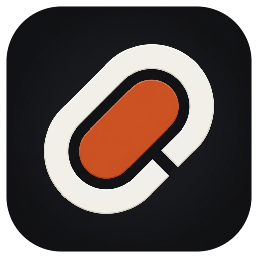
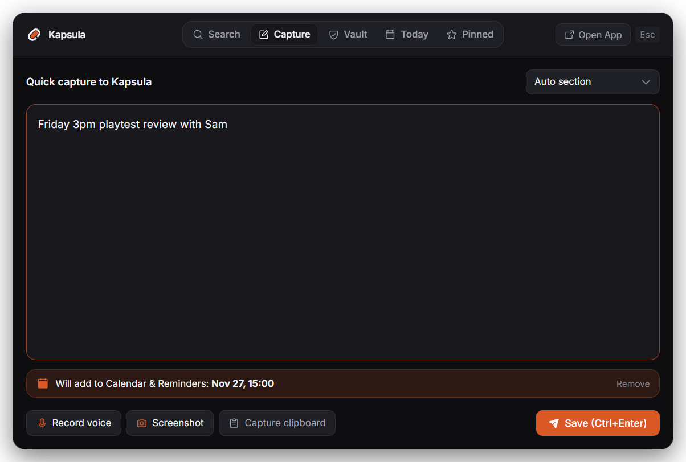
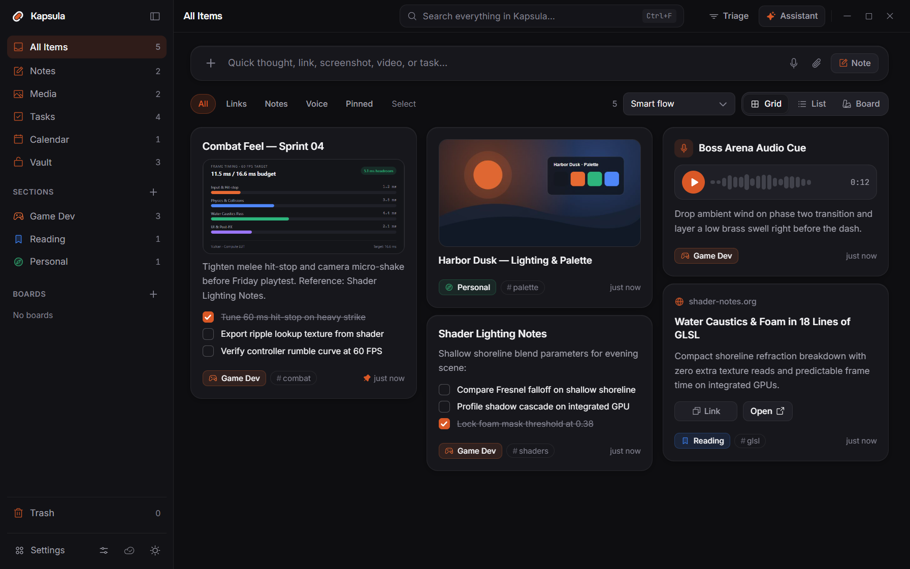
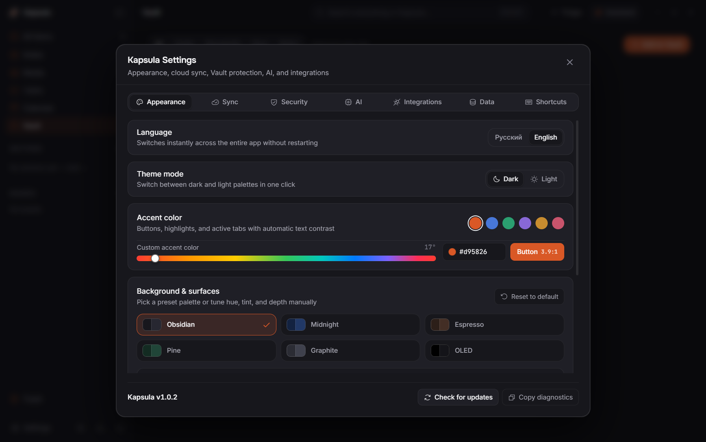
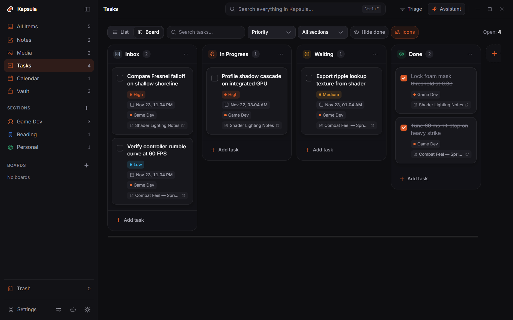
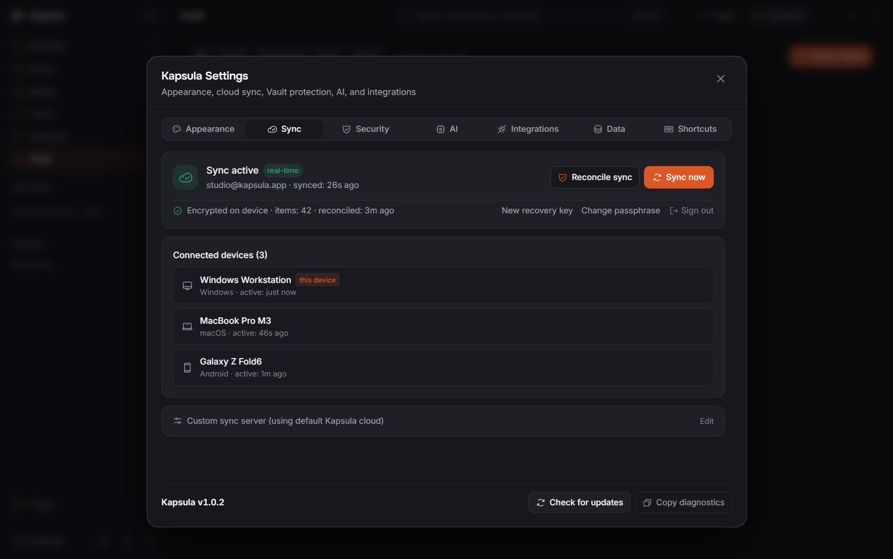
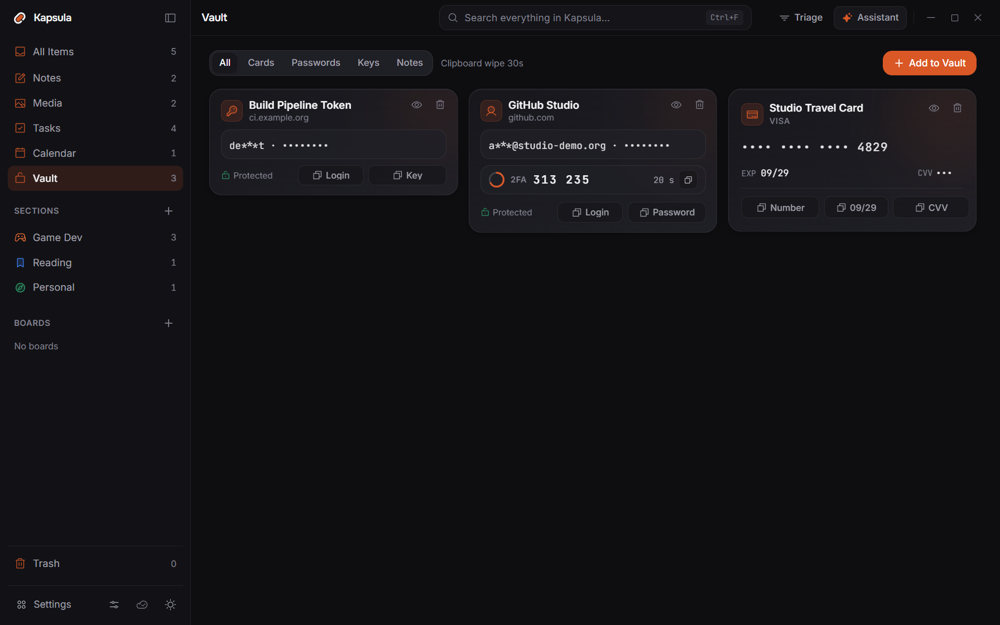

<div align="center">
  
  <h1>Kapsula</h1>
  <p>
    <strong>One place for notes, links, voice memos, tasks, and 2FA secrets.</strong><br />
    Offline-first on Windows, macOS, and Android — with optional end-to-end encrypted sync.
  </p>
  <p>
    <strong>English</strong> · <a href="README.ru.md">Русский</a> ·
    <a href="https://suther1and.github.io/kapsula/?lang=en">Website</a> ·
    <a href="https://github.com/Suther1and/kapsula/releases">Releases</a>
  </p>
</div>

<p align="center">
  
</p>

## Why Kapsula

Most note apps ask you to pick folders, templates, and workspaces before you can write a single sentence. Kapsula starts as one fast capture bar (`Alt + Space`) that works over any window — and only reveals deeper structure when your archive grows.

- **Instant capture & search (`Alt + Space`)** — jot a thought, paste a link, grab a screenshot, or record a voice memo without leaving your editor or browser. Natural dates like *“Friday 3pm”* turn into calendar reminders as you type.
- **Uncluttered Feed & Note Studio** — view everything in one calm stream, or open any card to write markdown notes with inline images, tags, checklists, and `[[cross-note links]]`.
- **Tasks that stay in sync with your notes** — `- [ ]` checklists inside any note automatically show up on the Kanban board and in the **By note** grouped task view.
- **2FA Vault & 30-second clipboard wipe** — store passwords, API keys, bank cards, and live 2FA codes behind a PIN or biometric lock. Anything copied clears from the clipboard after 30 seconds.
- **Adaptive mobile & Galaxy Z Fold** — Android app supports quick sharing from other apps, offline full-text search, and a two-pane notes layout on unfolded foldables.

<p align="center">
  
</p>

---

## Themes & Personal Appearance

Match Kapsula to your screen and lighting without squinting at tiny contrast bugs:

- Instant switch between **Dark** and **Light** palettes (`Obsidian`, `Pine`, `Midnight`, `Graphite`, `Porcelain`, `Sage`, `Ice`, `Paper`, plus OLED black).
- Preset accent swatches or a full hue slider — button and badge contrast recalculates automatically.
- Live **English / Русский** toggle right inside **Settings → Appearance** with zero restart.

<p align="center">
  
  &nbsp;
  
</p>

---

## End-to-End Encrypted Cloud Sync

Kapsula works 100% offline with zero account required. Sign in with **Google** or **email** whenever you want your Windows, macOS, and Android devices to stay in sync:

- **Encrypted before leaving your device** — notes, attachments, calendar events, and Vault secrets are encrypted locally with AES-256-GCM before upload.
- **Offline queue** — edit in airplane mode or underground; pending changes merge cleanly as soon as you reconnect.
- **Printable recovery key & custom server option** — back up one recovery key to restore your archive on a new machine, or point Kapsula to your own sync endpoint.

<p align="center">
  
  &nbsp;
  
</p>

<p align="center">
  
</p>

---

## Download v1.0.2

| Platform | File | Direct link |
| --- | --- | --- |
| **Windows 10 / 11** (64-bit) | `Kapsula-Setup-1.0.2.exe` | [Download .exe](https://github.com/Suther1and/kapsula/releases/download/v1.0.2/Kapsula-Setup-1.0.2.exe) |
| **macOS Apple Silicon** (M1–M4) | `Kapsula-1.0.2-arm64.dmg` | [Download .dmg](https://github.com/Suther1and/kapsula/releases/download/v1.0.2/Kapsula-1.0.2-arm64.dmg) |
| **macOS Intel** (x86_64) | `Kapsula-1.0.2-x64.dmg` | [Download .dmg](https://github.com/Suther1and/kapsula/releases/download/v1.0.2/Kapsula-1.0.2-x64.dmg) |
| **Android** (Phones & Foldables) | `Kapsula-1.0.2-android-release.apk` | [Download .apk](https://github.com/Suther1and/kapsula/releases/download/v1.0.2/Kapsula-1.0.2-android-release.apk) |

> **First launch note:** open-source releases do not include paid Windows EV or Apple Developer notarization certificates. On Windows SmartScreen, choose **More info → Run anyway**. On macOS, right-click the app in Applications and select **Open** (or run `xattr -dr com.apple.quarantine /Applications/Kapsula.app`).

---

## Building from Source

```bash
npm install
npm run dev        # run desktop app in development
npm test           # run unit and core verification tests
npm run pack:win   # package unpacked Windows build
```

## License

MIT — see [LICENSE](LICENSE).
