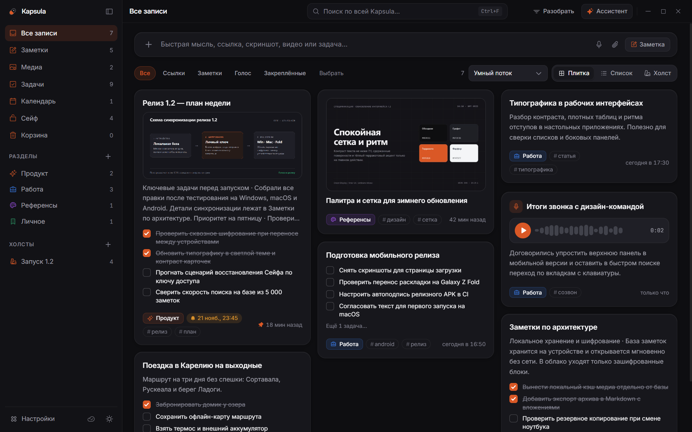
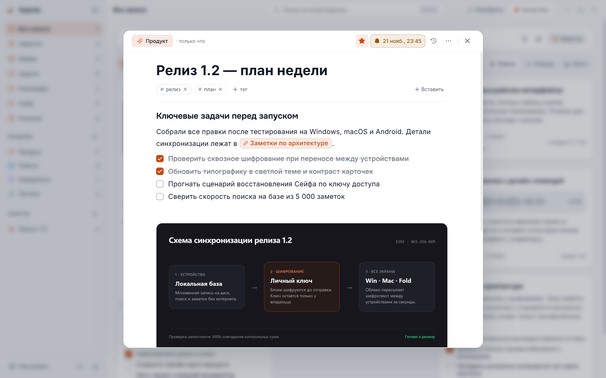
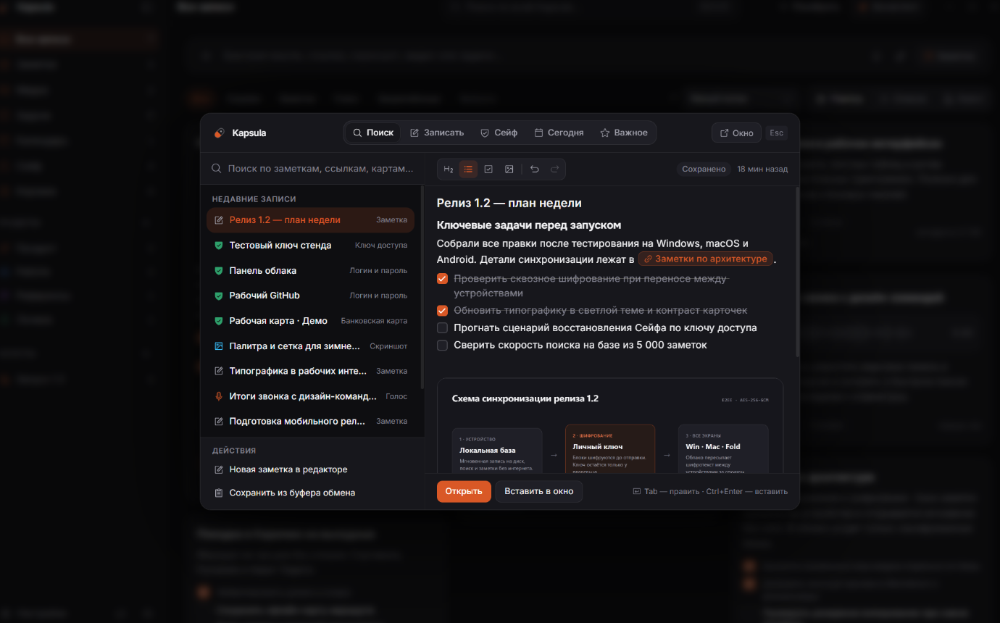
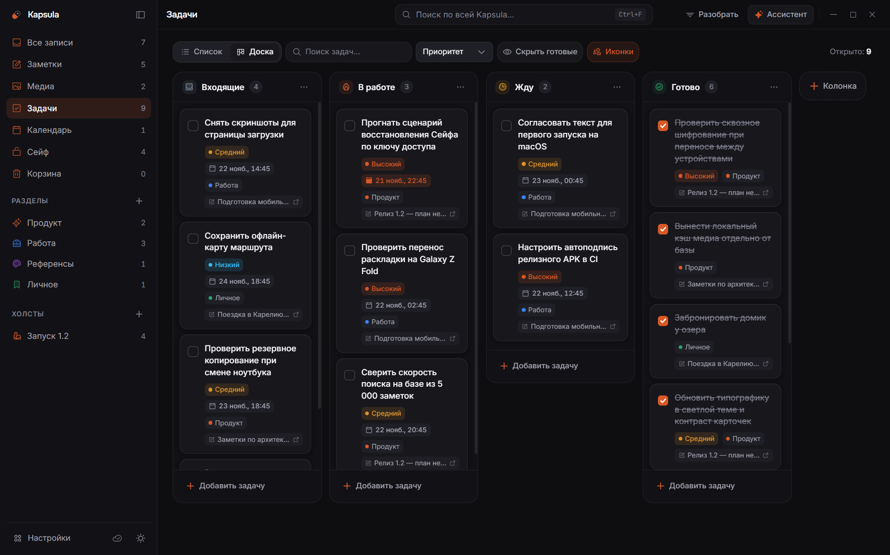
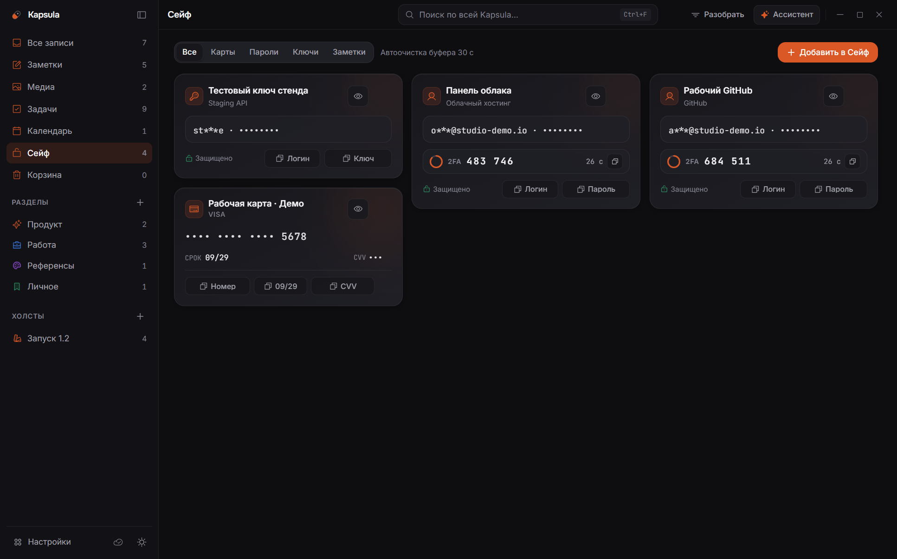
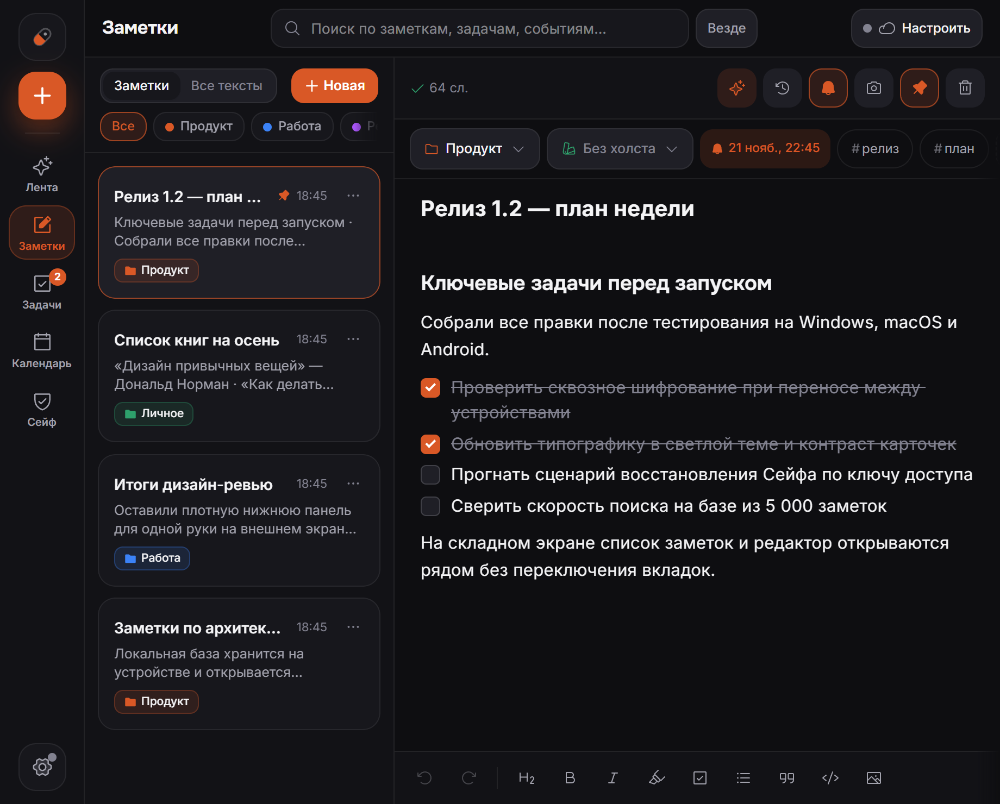

<p align="center">
  
</p>

<h1 align="center">Kapsula</h1>

<p align="center">
  Локальное хранилище для заметок, задач, закладок и&nbsp;зашифрованного Сейфа с&nbsp;2FA на&nbsp;Windows, macOS и&nbsp;Android.<br />
  Работает мгновенно без интернета и&nbsp;синхронизируется между устройствами со&nbsp;сквозным шифрованием.
</p>

<p align="center">
  <a href="https://suther1and.github.io/kapsula/"><strong>Страница проекта и&nbsp;демо</strong></a>
  &nbsp;·&nbsp;
  <a href="https://github.com/Suther1and/kapsula/releases/latest"><strong>Скачать последний релиз</strong></a>
  &nbsp;·&nbsp;
  <a href="LICENSE">MIT License</a>
</p>

<p align="center">
  
</p>

---

## Скачать

Актуальные сборки и&nbsp;контрольные суммы SHA-256 публикуются в&nbsp;[GitHub Releases](https://github.com/Suther1and/kapsula/releases/latest).

| Платформа | Файл | Архитектура и&nbsp;требования | Ссылка |
| --- | --- | --- | --- |
| **Windows** | `Kapsula-Setup-*.exe` | Windows 10 / 11 (x64), автообновления | [Скачать](https://github.com/Suther1and/kapsula/releases/latest) |
| **macOS (Apple Silicon)** | `Kapsula-*-arm64.dmg` | Apple M1–M4, macOS 13+ | [Скачать](https://github.com/Suther1and/kapsula/releases/latest) |
| **macOS (Intel)** | `Kapsula-*-x64.dmg` | Intel x64, macOS 13+ | [Скачать](https://github.com/Suther1and/kapsula/releases/latest) |
| **Android** | `Kapsula-*-android-release.apk` | Android 10+, поддержка Galaxy Z Fold | [Скачать](https://github.com/Suther1and/kapsula/releases/latest) |

> **Первый запуск без платных сертификатов подписи:**  
> На&nbsp;Windows при предупреждении SmartScreen нажмите **«Подробнее» → «Выполнить в&nbsp;любом случае»**. На&nbsp;macOS после переноса в&nbsp;«Программы» откройте приложение через **Правый клик → «Открыть»** (или выполните `xattr -cr /Applications/Kapsula.app` в&nbsp;Терминале).

---

## Что внутри

### Заметки, связи и&nbsp;быстрая панель (`Alt + Space`)

Полноценный Markdown-редактор с&nbsp;чек-листами, встроенными изображениями, историей версий с&nbsp;построчным сравнением и&nbsp;ссылками `[[между заметками]]`. По&nbsp;сочетанию **`Alt + Space`** поверх любого окна открывается плотная быстрая панель: мгновенный поиск по&nbsp;всей базе, голосовой ввод и&nbsp;редактирование выбранной записи в&nbsp;правой колонке без переключения окон.

| Центрированный редактор (светлая тема) | Быстрая панель (`Alt + Space`) |
| :---: | :---: |
|  |  |

### Канбан-доска и&nbsp;календарь

Все чек-листы из&nbsp;заметок автоматически попадают в&nbsp;раздел **«Задачи»**: их&nbsp;можно вести списком или на&nbsp;канбан-доске со&nbsp;своими колонками, приоритетами и&nbsp;сроками. Встроенный календарь поддерживает двустороннюю синхронизацию с&nbsp;Google Календарём, а&nbsp;также импорт и&nbsp;экспорт `.ics`.

<p align="center">
  
</p>

### Зашифрованный Сейф и&nbsp;2FA

Хранение банковских карт, паролей, ключей доступа и&nbsp;одноразовых кодов 2FA (TOTP) с&nbsp;живым таймером. Сейф закрывается мастер-PIN и&nbsp;системной биометрией, очищает буфер обмена через 30&nbsp;секунд после копирования, скрывается от&nbsp;записи экрана и&nbsp;никогда не&nbsp;передаётся в&nbsp;ИИ.

<p align="center">
  
</p>

### Windows, macOS и&nbsp;Android (включая Galaxy Z Fold)

Интерфейс одинаково работает в&nbsp;тёмной графитовой и&nbsp;светлой фарфоровой темах с&nbsp;настройкой акцента. Мобильное приложение для Android подстраивается под узкий внешний экран одной рукой и&nbsp;раскрывается в&nbsp;двухпанельный режим на&nbsp;складных экранах и&nbsp;планшетах.

<p align="center">
  
</p>

### Локальная база, облачная синхронизация и&nbsp;автообновления

- **Local-first:** заметки, вложения и&nbsp;полнотекстовый поиск хранятся локально в&nbsp;SQLite&nbsp;— приложение работает полностью офлайн.
- **Сквозное шифрование (E2EE):** при включении синхронизации записи шифруются на&nbsp;устройстве алгоритмом AES-256-GCM с&nbsp;ключом восстановления; сервер хранит только шифротекст.
- **ИИ по&nbsp;желанию:** расшифровка голоса, разбор ссылок и&nbsp;сводка по&nbsp;заметкам работают через встроенную облачную квоту или ваш собственный API-ключ Google AI / OpenRouter. Секреты и&nbsp;ключи вырезаются до&nbsp;отправки.
- **Импорт и&nbsp;экспорт без привязки:** перенос из&nbsp;Obsidian / Markdown, Notion (`.zip`), писем `.eml`, а&nbsp;также полный экспорт базы в&nbsp;Markdown с&nbsp;медиафайлами (`.zip`) или JSON-бэкап.

---

## Для разработчиков

**Стек:** Electron, React&nbsp;19, TypeScript, Vite&nbsp;8, Tailwind CSS&nbsp;4, TipTap, Motion, Capacitor&nbsp;8 (Android), локальный SQLite (FTS5), WebCrypto / Node `crypto` (AES-256-GCM + PBKDF2).

### Локальный запуск

Требуется Node.js&nbsp;22+ (для Android-сборки дополнительно JDK&nbsp;21 и&nbsp;Android SDK&nbsp;36).

```bash
npm ci
npm run typecheck
npm test
npm run build
npm start
```

### Сборка пакетов

```bash
# Windows: распакованная версия и установщик NSIS
npm run pack:win
npm run pack:win:installer

# macOS (.dmg под Apple Silicon, Intel или обе архитектуры — на macOS)
npm run pack:mac:arm64
npm run pack:mac:x64

# Android (.apk)
npm run build:mobile
npm run pack:android
```

---

## Лицензия

Проект распространяется под&nbsp;лицензией [MIT](LICENSE).
