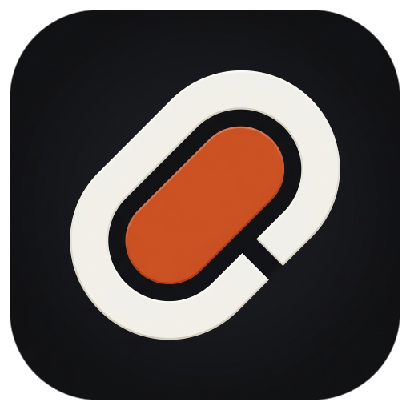
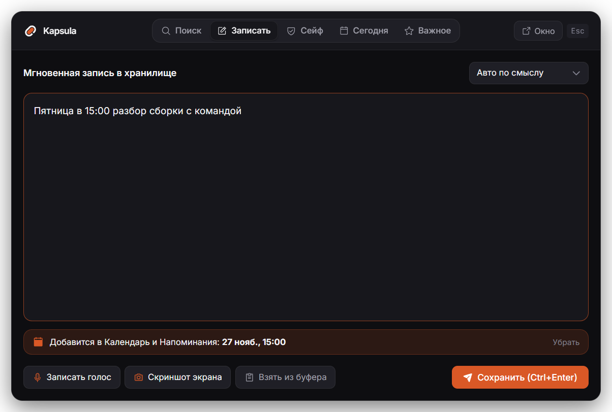
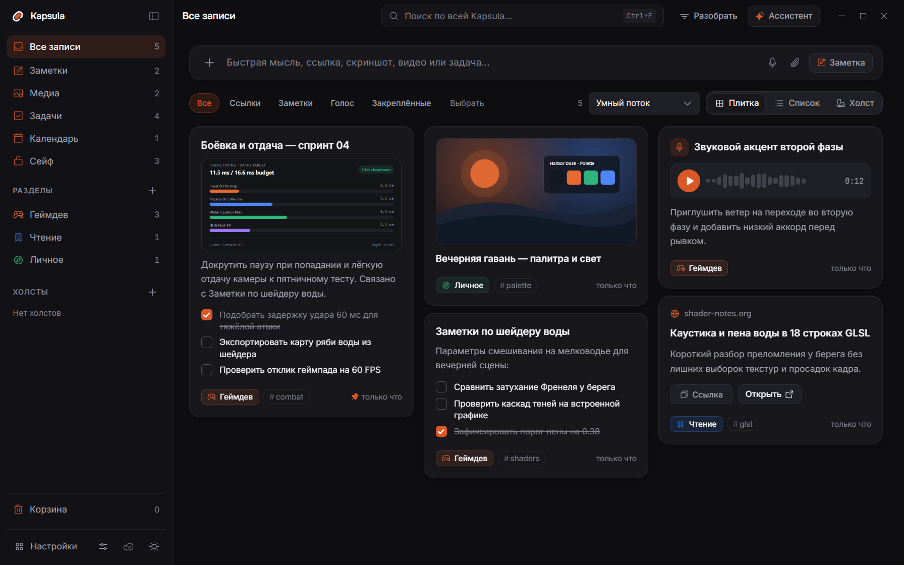
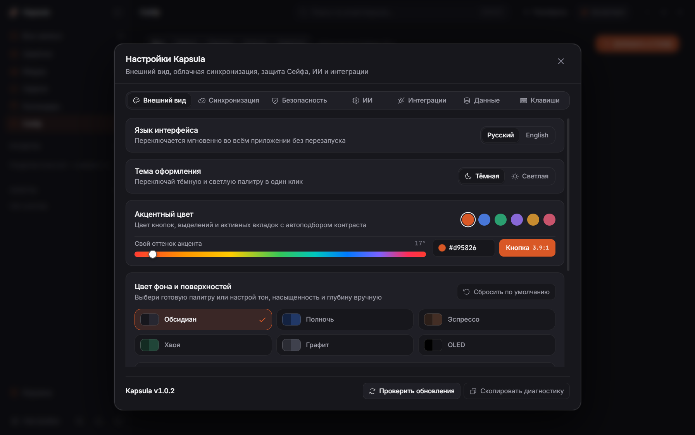
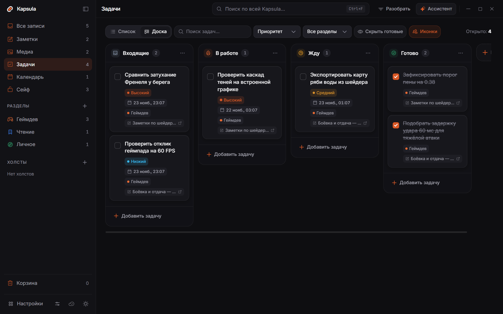
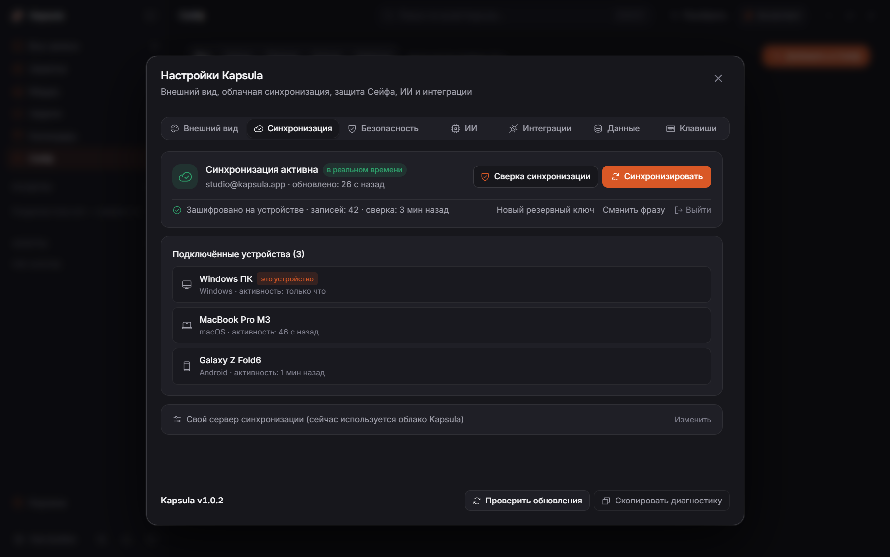
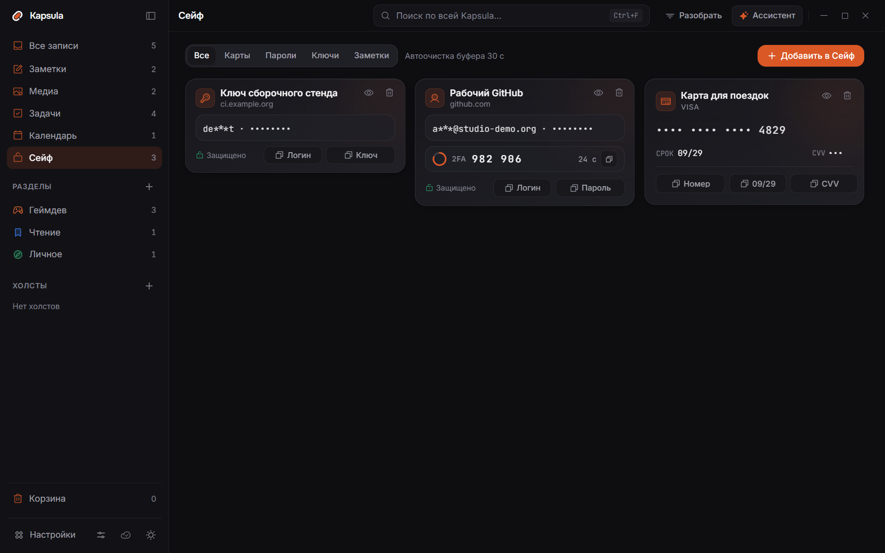
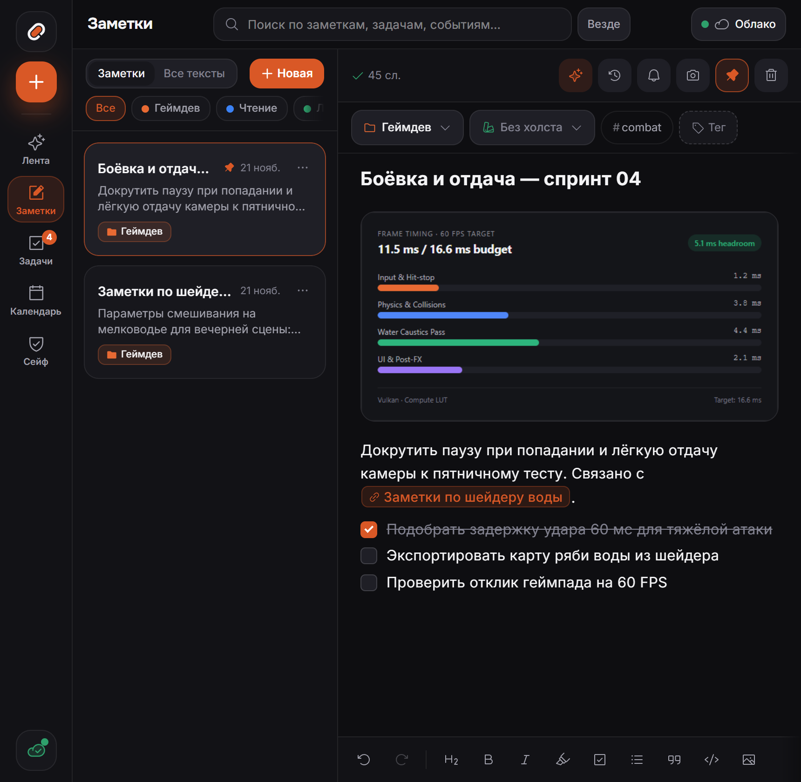

<div align="center">
  
  <h1>Kapsula</h1>
  <p>
    <strong>Одно окно для заметок, ссылок, голосовых записей, задач и кодов 2FA.</strong><br />
    Работает локально на Windows, macOS и Android — со сквозным шифрованием при включённой синхронизации.
  </p>
  <p>
    <a href="README.md">English</a> · <strong>Русский</strong> ·
    <a href="https://suther1and.github.io/kapsula/?lang=ru">Сайт</a> ·
    <a href="https://github.com/Suther1and/kapsula/releases">Релизы</a>
  </p>
</div>

<p align="center">
  
</p>

## Зачем нужна Kapsula

Обычные приложения для заметок сразу требуют заводить папки, базы и шаблоны. В Kapsula всё начинается с одной быстрой строки (`Alt + Space`), которая открывается поверх любого окна, а разделы, канбан и сейф подключаются только тогда, когда в них появляется смысл.

- **Быстрая запись и поиск (`Alt + Space`)** — сохраняйте мысли, ссылки, скриншоты и голосовые записи, не выходя из браузера или редактора. Фразы вроде *«пятница в 15:00»* сразу превращаются в напоминание.
- **Лента и редактор заметок** — просматривайте всё в общей ленте или откройте карточку: внутри поддерживаются картинки, теги, чек-листы и ссылки между заметками через `[[название]]`.
- **Задачи из текста на общей доске** — чек-листы `- [ ]` внутри любой заметки автоматически попадают на канбан-доску и в группировку **По заметке**. Отметка на доске обновляет саму заметку, и наоборот.
- **Сейф с 2FA и чистым буфером** — пароли, токены, банковские карты и живые таймеры 2FA закрыты ПИН-кодом или отпечатком. Скопированные секреты сами стираются из буфера обмена через 30 секунд.
- **Android и складные экраны** — мобильное приложение умеет принимать ссылки через «Поделиться», искать без сети и открывать список и редактор в две панели на Galaxy Z Fold.

<p align="center">
  
</p>

---

## Темы оформления и цвета

Внешний вид подстраивается под монитор и освещение с сохранением контраста:

- Переключение между **тёмной** и **светлой** темой с готовыми палитрами фона (графит, хвоя, полночь, светлый камень, шалфей, лёд, OLED).
- Готовые акценты и ползунок оттенка — читаемость текста на кнопках пересчитывается автоматически.
- Мгновенное переключение **Русский / English** прямо в **Настройки → Внешний вид** без перезапуска.

<p align="center">
  
  &nbsp;
  
</p>

---

## Шифрованная синхронизация

Аккаунт не обязателен: программа полностью работает на локальном диске. Если вы хотите, чтобы заметки, задачи и сейф синхронизировались между Windows, macOS и Android, войдите через **Google** или по **почте**:

- **Шифрование до отправки** — заметки, файлы и записи сейфа закрываются ключом AES-256-GCM прямо на вашем устройстве.
- **Очередь без интернета** — пишите в самолёте или в дороге: правки подтянутся на другие устройства после возвращения связи.
- **Резервный ключ и свой сервер** — сохраните резервный ключ восстановления при настройке или укажите адрес собственного сервера синхронизации.

<p align="center">
  
  &nbsp;
  
</p>

<p align="center">
  
</p>

---

## Скачать v1.0.2

| Платформа | Файл | Ссылка |
| --- | --- | --- |
| **Windows 10 / 11** (64-бит) | `Kapsula-Setup-1.0.2.exe` | [Скачать .exe](https://github.com/Suther1and/kapsula/releases/download/v1.0.2/Kapsula-Setup-1.0.2.exe) |
| **macOS Apple Silicon** (M1–M4) | `Kapsula-1.0.2-arm64.dmg` | [Скачать .dmg](https://github.com/Suther1and/kapsula/releases/download/v1.0.2/Kapsula-1.0.2-arm64.dmg) |
| **macOS Intel** (x86_64) | `Kapsula-1.0.2-x64.dmg` | [Скачать .dmg](https://github.com/Suther1and/kapsula/releases/download/v1.0.2/Kapsula-1.0.2-x64.dmg) |
| **Android** (телефоны и планшеты) | `Kapsula-1.0.2-android-release.apk` | [Скачать .apk](https://github.com/Suther1and/kapsula/releases/download/v1.0.2/Kapsula-1.0.2-android-release.apk) |

> **Замечание по первому запуску:** открытые сборки выходят без платной EV-подписи Windows и нотаризации Apple. В Windows SmartScreen нажмите **Подробнее → Выполнить в любом случае**. На macOS откройте приложение из «Программ» через правую кнопку мыши → **Открыть** (или выполните в терминале `xattr -dr com.apple.quarantine /Applications/Kapsula.app`).

---

## Сборка из исходников

```bash
npm install
npm run dev        # запуск десктопной версии в разработке
npm test           # проверка модульных и базовых тестов
npm run pack:win   # сборка распакованного приложения для Windows
```

## Лицензия

MIT — подробнее в [LICENSE](LICENSE).
